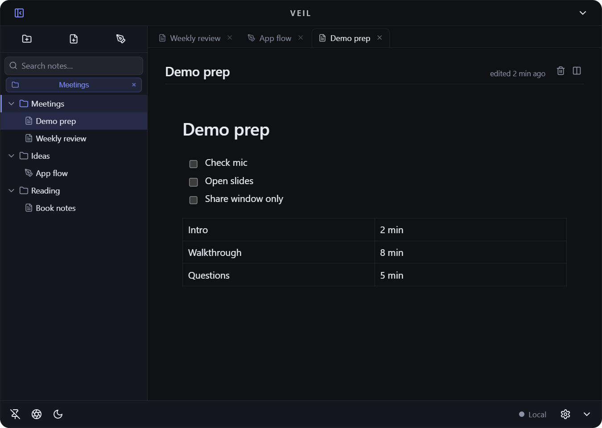
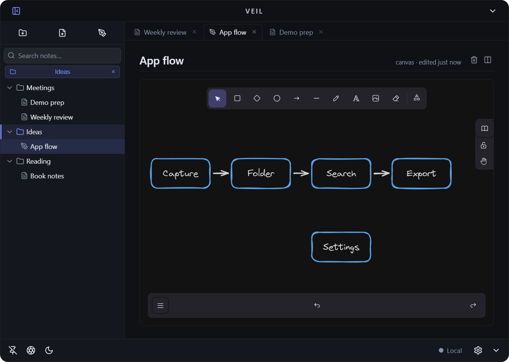
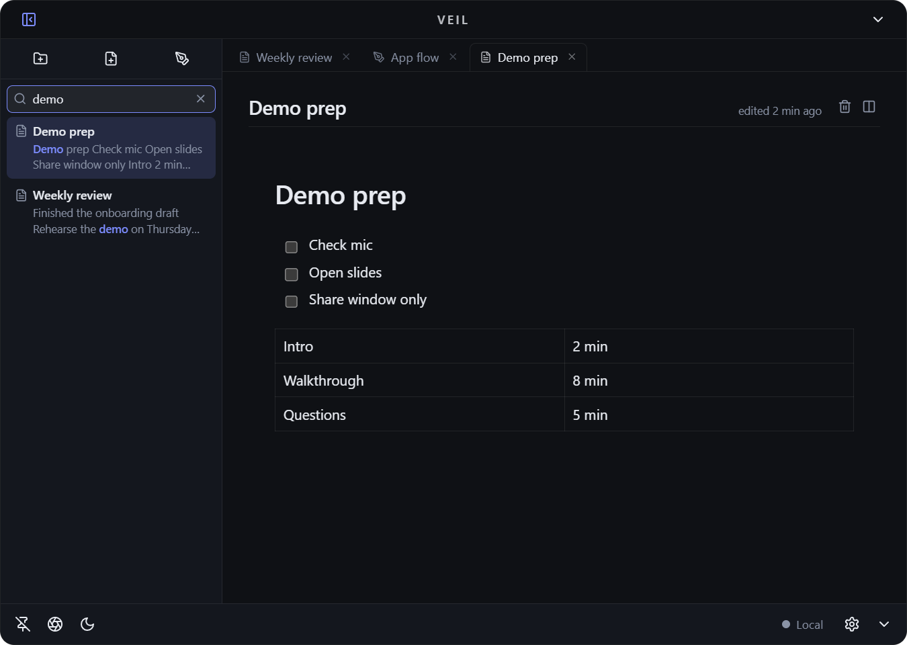
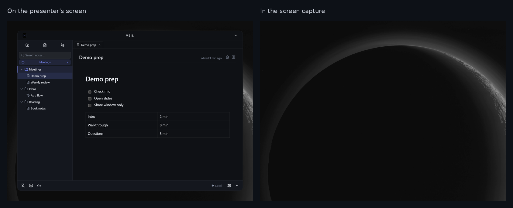
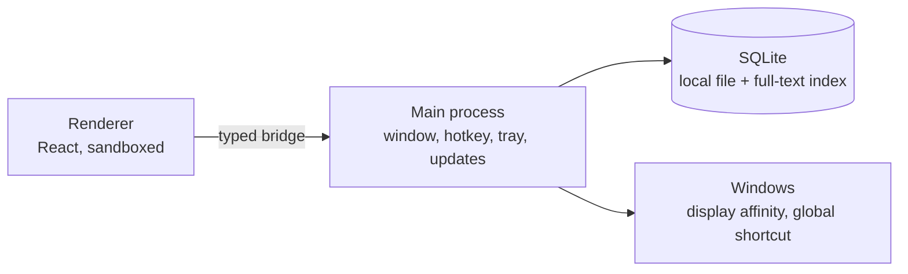

# Veil

A Windows notes pad summoned with a global hotkey, with a window that stays off shared screens. v1.0 complete and production-ready, not yet released. Built solo: product, architecture, desktop integration and packaging.

## Screenshots

## How it works

- **Capture:** a global hotkey opens a frameless, transparent pad over any app and closes it the same way. Notes are stored locally and open without a load step.
- **Notes:** rich-text documents (tables, task lists) and freeform canvas pages, organised in a folder tree with tabs and full-text search.
- **Screen-share invisibility:** the window is excluded from screen capture through the Windows display-affinity API. It stays visible to the person at the keyboard but does not appear in Zoom, Teams, Meet, OBS or Snipping Tool. The purpose is keeping personal notes off a shared screen while presenting. It does not block a camera pointed at the monitor or a hardware capture card. Windows drops the setting on some window transitions, so it is re-applied on every show, restore and focus.

## Architecture

All filesystem, database and OS work runs in the main process. The renderer is sandboxed under a strict content security policy and reaches the main process only through one typed bridge. Shared TypeScript types keep both sides in step.

## Engineering

- Production-readiness audit across security, functionality, data safety, UX and build. Security came back clean; the fixes went into data durability.
- Note writes and the search index commit in one transaction. Pending autosaves flush on quit and hide. Rolling local backups, with a recovery path if the database fails to open.
- Moved to Electron's built-in SQLite after a native module blocked an Electron upgrade, removing native rebuilds from the build.
- Canvas assets are self-hosted, so the app runs fully offline under the content policy.
- Windows installer with auto-update.

## Stack

TypeScript, Electron, React, TipTap, Excalidraw, SQLite

Source is private. I can walk through the code on request.
